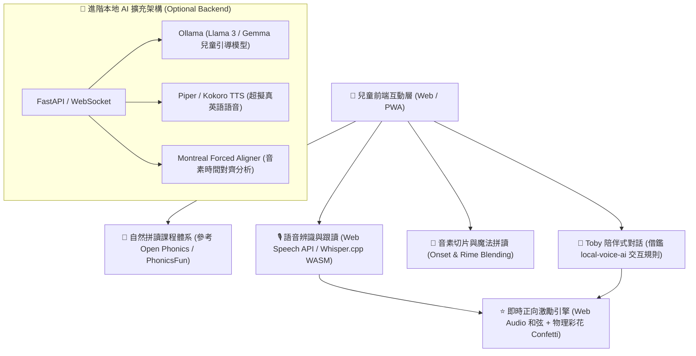

# 🌟 Phonics & Talk Adventure (幼兒開源自然發音與語音互動學習系統)

一個專為 4–9 歲兒童設計的**開源互動式自然發音（Phonics）與語音對話系統**。結合純前端零依賴體驗與現代語音 AI 技術架構，以「聽示範、玩拼讀、大聲說、正向激勵」為核心，讓孩子在無挫折感的歡樂情境中自然學會英語發音與日常對話。

---

## 📚 系統架構與開源方案整合藍圖

依據 **幼兒英文 AI 學習系統開源篩選方案**，本專案借鑑業界優秀開源專案之核心優勢進行整合設計：



### 推薦開源技術借鑑：
- **教材體系**：[Open Phonics](https://github.com/jonajinga/open-phonics) 與 [PhonicsFun](https://github.com/hanabi3558/PhonicsFun)（結構化音素、CVC 字族、分階段循序漸進）。
- **語音架構**：[local-voice-ai](https://github.com/ronnedahl/local-voice-ai)（本地語音轉文字、幼兒防護提示詞、即時語音對話）。
- **底層引擎**：[whisper.cpp](https://github.com/ggml-org/whisper.cpp)（輕量本地語音推論）、[Montreal Forced Aligner](https://github.com/MontrealCorpusTools/Montreal-Forced-Aligner)（音素級對齊評估）。

---

## 🎯 分齡學習模組設計 (Age-Adaptive Curriculum)

| 年齡階段 | 學習目標 | 互動方式 | 發音與回饋機制 |
|---|---|---|---|
| **🐣 4–5 歲 萌芽啟蒙島** | 單一字母音、活潑動物音、色彩與食物 | 大圖案點擊、慢速拆解音、趣味跟讀 | 聽一次、說一次，以讚賞激勵為主，不給挫折扣分 |
| **🚀 6–7 歲 探索拼讀島** | CVC 短母音拼讀、自然拼讀魔法鍋（Onset + Rime） | 字母積木拖曳拼字、字族切換、魔法合成 | 比對拼寫與音素正確性，獲得冒險星星 |
| **👑 8–9 歲 冒險會話島** | 雙輔音與複合音（sh, ch, th, ee）、生活短句與會話 | 麥克風即時語音回答、多選項日常問答 | 句子跟讀理解、鼓勵完整表達、累積成就勳章 |

---

## ✨ 核心互動亮點

1. 🔤 **發音探索與拼字（Phonics Playground）**：
   - 支援「標準整詞發音」、「慢速拆解」與積木卡槽回饋。慢速拆解會先念一次整個單字，接著依序亮起每個音素區塊，最後再慢速念一次整個單字。（瀏覽器語音只會念字母名，單獨的音素目前以提示音代替；真人音素錄音會於 #2 加入。）
2. 🎙️ **「換我說說看」跟讀模組（Listen & Repeat）**：
   - 點擊啟動麥克風，用瀏覽器語音辨識聽孩子念，分三個年齡層給予寬容評分：4–5 歲只要出聲就算過；6–7 歲比對「首音＋韻尾」（母音要對，尾音清濁放寬）；8–9 歲要念出完整單字。「用語音回答」同理：4–5 歲有出聲就過、6–7 歲說中選項關鍵字、8–9 歲要說一整句話。
   - 同一個字連續嘗試 3 次仍未通過，會送一顆「努力星」並再示範一次。
   - 辨識出來的文字不會顯示在畫面上。
   - 隱私提醒：瀏覽器的語音辨識會把聲音送到瀏覽器供應商（Chrome/Edge 為 Google/Microsoft、Safari 為 Apple）的服務處理；Firefox 不支援語音辨識。
3. 🥣 **自然發音拼讀魔法鍋（Word Blender）**：
   - 自由替換聲母（Onset）與韻尾（Rime），點擊金色大釜釋放魔法合成語音與動態煙火。
4. 🐻 **Toby 陪伴式情境對話（Magic Dialogue）**：
   - 支援「點選互動氣泡」與「直接對麥克風說話」雙重互動管道，培養敢於開口說英語的好習慣。
5. 🎉 **沈浸式獎勵系統**：
   - 內建 HTML5 Canvas 物理引擎彩花粒子（Confetti）、Web Audio API 動態多和弦樂音。

---

## 🚀 快速啟動與線上體驗

### 1. 線上免安裝版（GitHub Pages）
直接在手機、平板或電腦瀏覽器打開：  
🔗 **[https://zenobialin-ai.github.io/kids-phonics-adventure/](https://zenobialin-ai.github.io/kids-phonics-adventure/)**

### 2. 本機執行
```bash
# 下載本專案
git clone https://github.com/zenobialin-ai/kids-phonics-adventure.git
cd kids-phonics-adventure

# 以下兩種方式都需先安裝 Node.js

# 方式 A：Windows 雙擊 start.bat
# 方式 B：在命令列執行
node server.js
```

---
Made with ❤️ for young English learners worldwide. Open-source & child-friendly.
